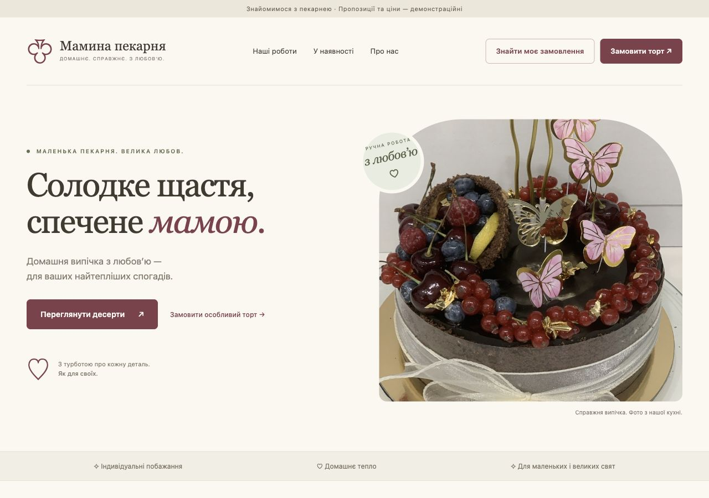
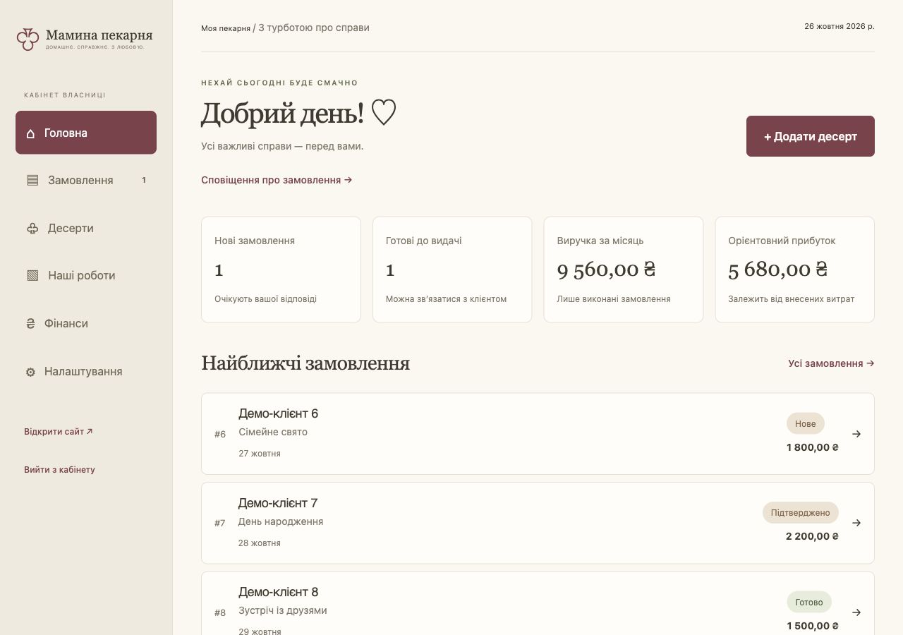
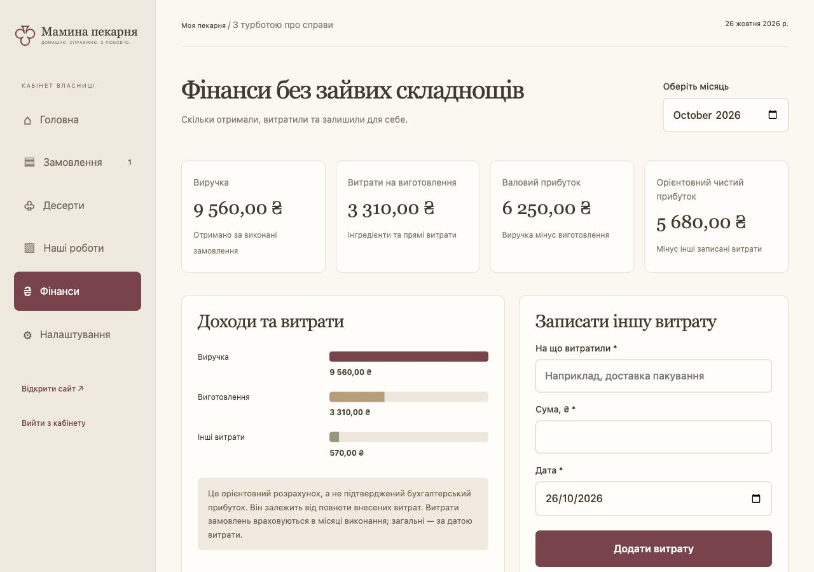
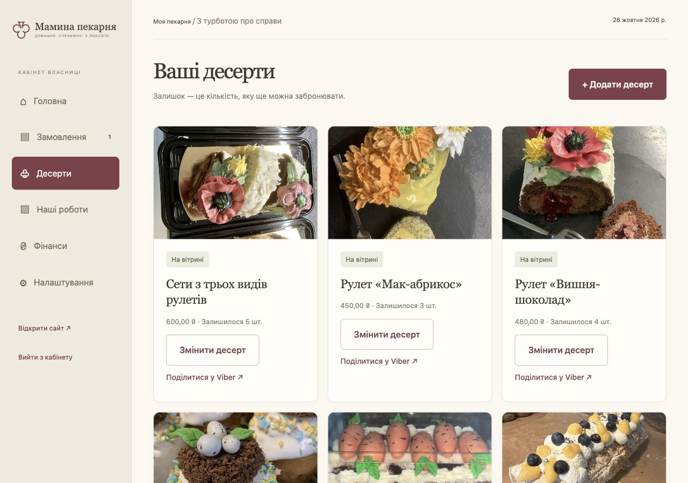
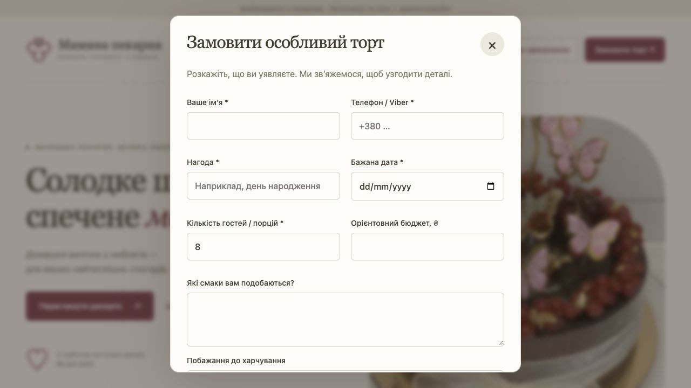
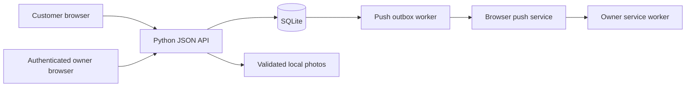

# Mom's Bakery · Мамина пекарня

A Ukrainian-language bakery storefront and private owner dashboard, built around one real family business. Customers reserve ready-made desserts or request a custom cake without creating an account. The owner manages stock, orders and estimated profit through a simple interface with large controls.

Built with Python, SQLite and vanilla JavaScript, with real photographs of homemade cakes. Developed iteratively with OpenAI Codex, guided by the owner's everyday workflow and feedback from iPhone testing.

**Status:** working local MVP / portfolio project. Not a hosted production service. Prices, stock and orders in the screenshots are illustrative; the cake photographs are real. Web Push is implemented but requires HTTPS, server configuration and device permission before notifications can be delivered.



## Why this project

The intended owner is in her 60s and runs a small homemade bakery in Ukraine. The goal is to reduce the effort of taking orders through messages, keeping track of available batches and understanding costs—without introducing a complicated ERP or customer registration.

The application uses Ukrainian throughout, hryvnia (UAH / ₴), Ukrainian number/date formatting and Europe/Kyiv business dates.

## Features

| Customer experience | Owner workspace |
| --- | --- |
| Photo gallery with categories and inspiration links | Product and batch publishing with safe image uploads |
| Available desserts with quantity-based reservations | Stock updates and one-tap order statuses |
| Separate custom cake requests and inspiration photos | Customer contacts, allergy notes and order details |
| Read-only ingredients/allergens on ready-made products | Owner-maintained ingredient/allergen information |
| Private tracking links, remembered on the same device | Per-unit production costs copied into new reservations |
| Copy, native sharing and Viber links | Monthly revenue, recorded expenses and estimated profit |
| No customer accounts or checkout email requirement | Optional Web Push with a persistent retry queue |

A custom request is never automatically confirmed. Dietary needs and allergens must be reviewed by the owner. Unknown ingredients are explicitly shown as unknown.

## Screenshots

All screenshots were captured from a separate database containing fictional demo orders. No real customer records or business finances are published.

| Owner overview | Financial overview |
| --- | --- |
|  |  |

| Batch management | Custom cake request |
| --- | --- |
|  |  |

See [the screenshot pack and LinkedIn caption](docs/PORTFOLIO.md).

## Technology

- **Frontend:** semantic HTML, responsive CSS and vanilla JavaScript; no frontend build step.
- **Backend:** Python's `ThreadingHTTPServer` with JSON endpoints.
- **Persistence:** SQLite with additive schema migrations and transactional inventory updates.
- **Images:** Pillow for validation, EXIF orientation, resizing and metadata removal on upload.
- **Authentication:** scrypt password hashes and expiring HttpOnly, SameSite session cookies.
- **Notifications:** `pywebpush`, VAPID signing, a service worker and an installable web app manifest.
- **Tests:** Python `unittest` and Node's built-in `vm` / assertions. No Node runtime dependency for the application itself.



## Run locally

Requires Python 3.11+ (3.12 recommended), SQLite support and timezone data. Node.js is only needed for the frontend tests.

```sh
git clone https://github.com/Timuridzone/moms-bakery.git
cd moms-bakery
python3 -m venv .venv
.venv/bin/python -m pip install -r requirements.txt
./start.sh --set-password
.venv/bin/python import_photos.py
./start.sh --port 8013
```

Open **http://127.0.0.1:8013/** or **http://127.0.0.1:8013/admin**. Set your own owner password; the normal application has no default password. `--set-password` also invalidates existing sessions.

On Windows, replace `./start.sh` with `.venv\Scripts\python server.py` and use that Python path for other commands. Install `tzdata` if your system has no IANA timezone database.

### Separate portfolio demo

This writes only to `data/portfolio-demo`, preserving the normal working database:

```sh
.venv/bin/python scripts/seed_demo.py
BAKERY_DATA="$PWD/data/portfolio-demo" ./start.sh --port 8014
```

Visit `http://127.0.0.1:8014/admin`. The **fictional localhost demo only** uses password `portfolio-demo-local`. Do not deploy this demo database or use that password for real data. The seed script does not reset a populated demo.

### Local iPhone testing

```sh
BAKERY_SECURE_COOKIE=0 ./start.sh --lan --port 8013
ipconfig getifaddr en0
```

With both devices on the same trusted Wi-Fi, open `http://<Mac-LAN-IP>:8013/`. `--lan` opts into `0.0.0.0`; the default remains loopback-only. Do not configure a public tunnel or router port forwarding for this development server. HTTP LAN testing does **not** enable iPhone push notifications.

## Configuration

Copy `.env.example` to `.env` if needed; process environment values take precedence.

| Variable | Purpose |
| --- | --- |
| `BAKERY_DATA` | Database, uploads and generated keys directory; defaults to `data/` |
| `BAKERY_SECURE_COOKIE` | `1` for HTTPS deployment; `0` for localhost / LAN HTTP development |
| `BAKERY_ADMIN_PASSWORD` | Optional initial password, used only if no owner password exists |
| `BAKERY_PUSH_SUBJECT` | Actual HTTPS contact URL or `mailto:` contact for the push service |

VAPID keys are generated server-side and saved privately under the data directory. They are never sent to the frontend. No email provider or paid integration is required.

Detailed guides: [Ukrainian setup](docs/SETUP_UK.md) · [Order recovery](RECOVERY.md) · [Web Push setup](PUSH_SETUP.md).

## Important implementation decisions

- **No overselling:** `BEGIN IMMEDIATE` serializes stock checks and decrements. A unique request key makes retrying a submission idempotent.
- **Cancellation:** reserved stock is restored exactly once; cancelled orders cannot be reopened.
- **Historical costs:** reservation costs snapshot the per-unit cost at checkout; later product edits do not rewrite past order estimates.
- **Money:** integer kopiykas in the database, formatted as hryvnia in the UI.
- **Privacy:** public responses omit customer contact details and owner costs. Order status requires an unguessable bearer token. Local recovery stores only tracking references on that browser/device.
- **Uploads:** accepted raster formats are decoded, size-limited and re-encoded; custom inspiration photos require owner authentication to view.
- **Notifications:** order creation and notification enqueueing share a transaction; delivery happens afterward with bounded retries. Notification payloads omit contact details, finances and customer tracking tokens.
- **LAN compatibility:** checkout identifiers use `crypto.getRandomValues`, avoiding startup failure when `randomUUID` is unavailable on HTTP origins.

## Tests

```sh
.venv/bin/python -m unittest discover -s tests -p 'test_*.py'
node tests/test_frontend.cjs
node tests/test_push_frontend.cjs
```

The suite covers concurrent reservations, duplicate submissions, cancellation, costs, privacy, uploads, migrations, separate custom requests, device recovery, push retries and encryption with a mocked network transport. CI runs these checks on pushes and pull requests.

## Scope and deployment limits

This is an MVP for one owner, not a production hosting template. Before public use, add an appropriate production server/reverse proxy, HTTPS, persistent storage, backups and operational monitoring; review network rate limiting and proxy behavior for the chosen deployment. Python's built-in HTTP server should not be exposed directly to the public internet.

- Pickup only; delivery negotiation is a future feature.
- No card payments, customer accounts, CRM or advanced recipe inventory.
- Finance totals are estimates based on recorded expenses, not verified accounting profit.
- Recovery across devices requires the original tracking link or contacting the bakery.
- Real iPhone push delivery still requires deployment and device testing; automated tests mock the provider.

## Repository layout

```text
server.py              HTTP routes, validation, schema, inventory and authentication
notifications.py       Web Push subscriptions and durable delivery queue
configuration.py       Environment file loading
import_photos.py       Idempotent named-photo import
static/                Storefront, owner UI, styles, manifest and service worker
pics/                  Bakery photographs used to seed the gallery
scripts/seed_demo.py    Isolated, fictional portfolio dataset
tests/                 Backend and frontend regression checks
docs/                  Setup, portfolio copy and screenshots
```

The database, customer uploads, sessions, local credentials, private keys and historical screenshots are excluded from Git. The code is published for portfolio review; no broad reuse license is granted here. Bakery photographs remain the owner's work and should not be reused without permission.
